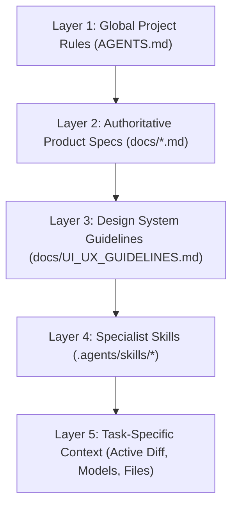

# byteInn — Agent Workflow & Context Engineering Framework

**Status**: Authoritative Reference  
**Version**: 1.0 (Phase 0.5)  
**Target Audience**: AI Agents, Orchestrators, Software Engineers

---

## 1. System Purpose & Architecture

The byteInn Agent System is a persistent, project-specific capability designed to guide AI pair-programming, multi-turn development, and specialist engineering roles consistently across design, implementation, testing, code review, security, and documentation.

Instead of pasting the entire project history into every conversation, the system relies on a **Five-Layer Context Hierarchy** and **Progressive Disclosure** to deliver high-quality, verified results without context bloat.

---

## 2. Five-Layer Instruction Hierarchy & Precedence



### Precedence & Authority Rules:
1. **Rule of Specificity & Governance**:
   - `AGENTS.md` defines the non-negotiable core rules, orchestrator loop, and safety invariants.
   - For business behavior, database invariants, and scope boundaries, the approved V1 specifications in `docs/` are the authoritative source of truth.
   - For visual styling, components, and layout, `docs/UI_UX_GUIDELINES.md` governs.
   - If a skill or user prompt conflicts with an approved V1 specification, **stop and ask the user** rather than silently inventing new patterns.
2. **Progressive Disclosure Principle**:
   - An agent must NEVER load all documentation files unconditionally.
   - An agent loads Layer 1 (`AGENTS.md`) at the start of a task.
   - Specialized instructions in Layer 4 (skills) and Layer 2/3 (specs) are loaded on-demand based on the task domain.

---

## 3. Seven Specialist Engineering Roles

The orchestrator operates as a senior lead engineer, delegating to or executing these specialist responsibilities:

| Specialist Role | Primary Responsibilities | Key Reference / Skill |
| :--- | :--- | :--- |
| **SaaS Product Designer** | Visual tokens, application shell, information density, accessibility, theme parity. | `docs/UI_UX_GUIDELINES.md`, `.agents/skills/design-system` |
| **Frontend Implementation** | Next.js 16 App Router client/server components, shadcn/Base UI, state feedback. | `docs/CODING_STANDARDS.md`, `.agents/skills/implement-spec` |
| **Backend / Architecture** | Modular monolith services, PostgreSQL transactional integrity, financial decimal precision. | `docs/byteInn_Architecture_v1.md`, `.agents/skills/implement-spec` |
| **Code Review Specialist** | Independent diff review, invariant verification, severity-ranked findings. | `.agents/skills/code-review` |
| **QA / Testing Specialist** | Node test runner suites, regression tests, edge/adversarial test cases. | `docs/CODING_STANDARDS.md`, `.agents/skills/testing` |
| **Security Specialist** | Server-side authorization, JWT cryptographic validation, rate limiting, data protection. | `artifacts/*Security_Audit.md`, `.agents/skills/security-review` |
| **Context Maintenance** | Living documentation sync, decision logging, handoff preparation. | `.agents/skills/context-maintenance`, `.agents/skills/handoff` |

---

## 4. Standard 11-Step Development Lifecycle

For all non-trivial tasks, follow this standardized execution lifecycle:

1. **Understand Scope**: Identify acceptance criteria and verify boundaries against V1 scope protections.
2. **Inspect Active State**: Inspect real code, schemas, and git working status. Never assume documentation is up to date without checking code.
3. **Map Impact & Risks**: Identify affected components, API routes, database models, permissions, tests, and documentation.
4. **Formulate Implementation Plan**: Develop a concise plan with proposed changes and verification steps. Request approval when required.
5. **Implement in Focused Increments**: Make minimal, coherent edits following modular monolith patterns.
6. **Add Automated Tests**: Write unit/integration tests in `tests/` covering happy paths, errors, and boundary conditions.
7. **Execute Verification Gate**: Run `npm run validate` (`tsc --noEmit`, `eslint`, `npm test`). Fix any introduced regressions immediately.
8. **Independent Code Review**: Inspect the git diff against the code review checklist.
9. **Resolve Review Findings**: Fix any blocker, high, or medium findings and re-verify.
10. **Synchronize Living Documentation**: Update relevant `docs/` or README files to reflect real contracts.
11. **Produce Concise Handoff / Completion Report**: Detail what changed, what was verified, commands run, and git status.

---

## 5. Context Engineering Best Practices

1. **Targeted Context Retrieval**:
   - Start from the specific task.
   - Grep for symbols or routes rather than reading entire folders.
   - Read the smallest useful set of files first, then expand if needed.
2. **Impact Mapping**:
   - Trace data flows end-to-end (Frontend UI → Route Handler → Domain Service → Prisma Query → PostgreSQL).
   - Check all callers before changing shared service method signatures or DTOs.
3. **Decision Preservation**:
   - Record architectural or product decisions in authoritative documents.
   - Never silently reverse an existing architectural invariant.
4. **Living Documentation Protocol**:
   - Update documentation immediately when contracts change.
   - Never document an unreleased feature as completed.
5. **Evidence-Based Completion**:
   - Never claim a test, build, or review passed without actual executed command output.
   - Distinguish test pass from proof of absence of all edge cases.

---

## 6. Engineering Handoff Protocol & Template

When pausing work, completing a stage, or handing off to another agent session, produce a compact handoff using this format:

```markdown
# byteInn Engineering Handoff: [Task / Stage Name]

## 1. Objective & Scope Status
- **Goal**: [Summary]
- **Status**: [STAGE COMPLETE / READY FOR NEXT STAGE / BLOCKED]

## 2. Changes Implemented
- `file1.ts`: [What changed and why]
- `file2.tsx`: [UI or client adjustments]

## 3. Verification Executed
- `npm run validate`: [Result, error count, test pass count]
- `npm run build`: [Next.js build status, route count]

## 4. Architectural Invariants Preserved
- [Confirmation of security, transactional integrity, and scope boundaries]

## 5. Next Planned Actions
- [Clear, actionable next step for the incoming session]
```
